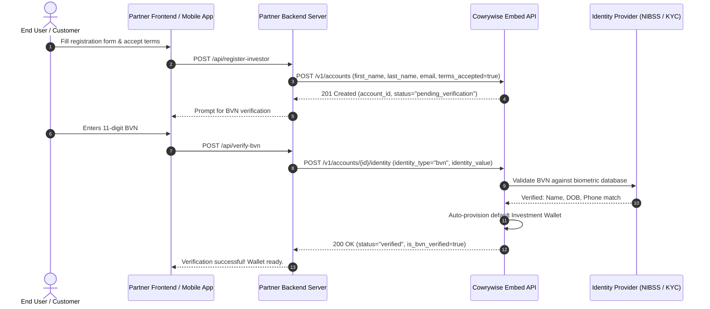
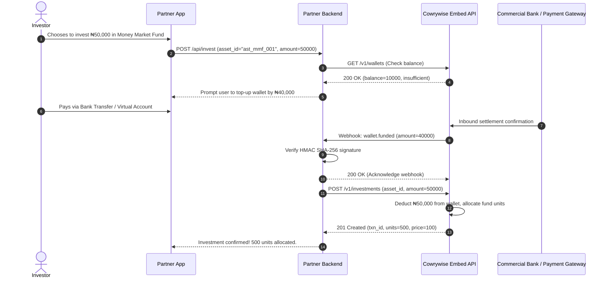
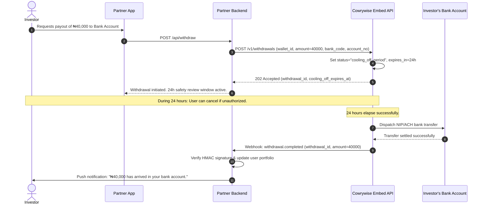

# Cowrywise Embed Architecture & Sequence Diagrams

This document visualizes the core asynchronous workflows and data boundaries when integrating Cowrywise Embed into your partner application.

---

## 1. Customer Onboarding & KYC Identity Flow

Regulatory compliance requires identity verification before wallets or investments can be initialized.



---

## 2. Wallet Funding & Mutual Fund Purchase Flow

Wallets serve as the sole funding source and withdrawal destination for all investment products.



---

## 3. Asynchronous Liquidation & 24-Hour Cooling-Off Period

To protect against account takeovers and accidental withdrawals, Cowrywise Embed enforces a regulatory 24-hour intent cooling-off period.



---

## 4. Webhook Event Loop with HMAC Verification

```mermaid
flowchart TD
    A[Cowrywise Event Occurs: wallet.funded, etc.] --> B[Cowrywise signs CLIENT_ID with CLIENT_SECRET]
    B --> C[HTTP POST to Partner Webhook Endpoint]
    C --> D{Partner Webhook Listener}
    D -->|Step 1| E[Compute HMAC-SHA256(CLIENT_ID, CLIENT_SECRET)]
    E -->|Step 2| F{crypto.timingSafeEqual?}
    F -->|Mismatch| G[Return HTTP 401: Unauthorized / Reject Request]
    F -->|Match| H[Check Event Idempotency in Redis/DB]
    H -->|Already Processed| I[Return HTTP 200: Ignore Duplicate]
    H -->|New Event| J[Update Local Database & Notify User]
    J --> K[Return HTTP 200 within 3 seconds]
```
