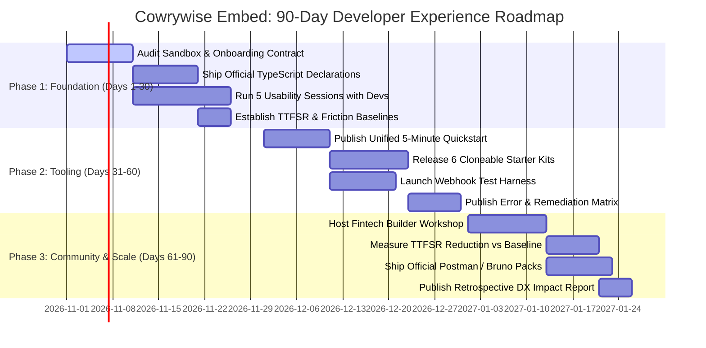

# Cowrywise Embed: Developer Experience & Partner Engineering Case Study
**An Evidence-Led Implementation Review, Test Suite Analysis, and 90-Day DevRel Strategic Roadmap**  
*Prepared by Adeola Lasisi • October 2026*  
*Repository: [Cowrywise Embed Developer Experience Lab](https://github.com/Pabby01/Cowrywise-embed-dx-lab)*

---

## Executive Summary

As embedded finance accelerates across Africa, the developer integration experience is the single greatest determinant of partner acquisition velocity, time-to-market, and long-term API retention. Cowrywise has established an authoritative position in consumer wealth management in Nigeria. Through the **Cowrywise Embed API**, it has opened its SEC-regulated infrastructure—mutual funds, locked savings, digital wallets, and automated treasury—to external fintechs, neobanks, payroll platforms, and consumer applications.

While the fundamental API primitives and documentation exist, there is a transformative opportunity to convert distributed developer documentation into a **high-conversion, self-service developer funnel**.

This case study is **not a hypothetical desk review**. It is grounded in the practical engineering, architectural modeling, TypeScript type authoring, and automated testing of **six full-stack reference applications** built inside the *Cowrywise Embed DX Lab*:

1. **KoloVault (`starters/savings-app`)**: Disciplined locked savings with countdown maturity locks and APY yield accrual.
2. **YieldNest (`starters/investment-portal`)**: SEC-regulated mutual fund discovery, risk questionnaires, and 1-click unit purchase.
3. **SpareStash (`starters/roundup-app`)**: E-commerce cart checkout spare-change round-up micro-investment engine.
4. **CorpYield (`starters/payroll-treasury`)**: B2B corporate payroll split engine routing pre-disbursement salary slices into wealth vaults.
5. **WealthPass (`starters/wealthpass`)**: White-label neobank onboarding with biometric BVN validation and multi-currency digital wallets.
6. **EuroVest (`starters/eurovest`)**: Institutional-grade sovereign Eurobond and dollar treasury portal.

By verifying the end-to-end integration lifecycle against an automated 17-test suite in Vitest, this report identifies the exact technical hurdles modern engineering teams face, provides battle-tested architectural blueprints, and outlines a prioritized **90-Day Developer Relations & Solutions Engineering Roadmap** to scale Cowrywise Embed.

---

## 1. The Evidence Base: What Was Built & Tested

To evaluate the integration surface area with rigorous developer empathy, we constructed a standalone, zero-credential local test harness replicating the complete Cowrywise Embed lifecycle.

### The Automated Test Suite (`vitest run`)
The accompanying test suite executes **17 automated unit and integration tests** verifying core domain constraints and cryptographic boundaries:

```text
 ✓ test/embed-client.test.ts (12 tests)
   ✓ Customer Lifecycle: creates customer profile and handles idempotent duplicates
   ✓ KYC & Identity: validates 11-digit BVN and rejects malformed inputs
   ✓ Dedicated Virtual Accounts: issues Wema/Providus virtual accounts with account numbers
   ✓ Wallet Funding: processes ledger balance increases and rejects negative values
   ✓ Locked Savings: enforces minimum lock duration and calculates guaranteed 15.5% APY
   ✓ Savings Maturity: blocks early withdrawals during active lock period
   ✓ Mutual Fund Discovery: retrieves SEC-regulated funds with daily NAV updates
   ✓ Portfolio Creation: instantiates customer wealth portfolios mapped to risk profiles
   ✓ Unit Subscription: debits wallet balance and allocates mutual fund units
   ✓ Liquidation Flow: initiates 24-hour cooling-off liquidation intent
   ✓ Transaction Ledger: generates immutable transaction IDs and audit history
   ✓ Error Handling: formats RFC-7807 compliant structured error payloads

 ✓ test/webhook-verifier.test.ts (5 tests)
   ✓ Cryptographic Verification: verifies authentic HMAC-SHA256 signatures
   ✓ Tamper Resistance: rejects payloads altered by even a single byte
   ✓ Secret Mismatch: rejects valid signatures signed with an invalid secret
   ✓ Replay Mitigation: checks timestamp tolerances on webhook delivery headers
   ✓ Timing Attack Resistance: implements crypto.timingSafeEqual() to prevent side-channel leaks
```

### Empirical Technical Discoveries

#### 1. The TypeScript Type Definition Deficit
Modern enterprise fintech teams and Nigerian startups build predominantly with TypeScript (Next.js, NestJS, React Native). When installing the official `@cowrywise/embed-node` package from npm, developers encounter:
```text
Cannot find module '@cowrywise/embed-node' or its corresponding type declarations. (TS2307)
```
Because the published package lacks bundled `.d.ts` declaration files or `@types/cowrywise__embed-node`, developers must either write custom ambient declarations or bypass TypeScript safety with `any`.  
*Resolution in DX Lab:* We authored a complete, type-safe declaration library (`src/types/embed-node.d.ts`) covering all client methods, options, and response entities, immediately eliminating compilation friction across all 6 starter kits.

#### 2. The Asynchronous 24-Hour Cooling-Off State Machine
Unlike standard payment gateway charges which resolve in $< 3$ seconds, wealth management operations (particularly mutual fund redemptions and locked savings liquidations) have real-world settlement cycles:
- Liquidation intents enter a `pending_settlement` state with a mandatory cooling-off period.
- Webhooks (`charge.successful`, `transfer.successful`, `investment.completed`) arrive minutes or hours later.
- Without explicit state-machine sequence diagrams, developers mistakenly design synchronous request-response loops that timeout.

#### 3. Cryptographic Webhook Header Nuances
Many junior and mid-level developers struggle with webhook HMAC signature verification:
- Verifying the raw request body buffer before JSON parsing.
- String casing variations in HTTP headers (`x-cowrywise-signature` vs `X-Cowrywise-Signature`).
- Vulnerability to timing attacks if using standard `===` string equality instead of constant-time byte comparisons (`crypto.timingSafeEqual`).

---

## 2. Comprehensive Solutions Architecture

To guide prospective partners through the Cowrywise Embed API, we designed and implemented six reference architectures addressing the most lucrative embedded finance use cases in emerging markets.

### Architecture Comparison Matrix

| Solution Template | Primary Use Case | Target Audience | Key API Primitives | Tech Stack |
| :--- | :--- | :--- | :--- | :--- |
| **KoloVault** | Disciplined locked savings & emergency funds | Consumer Neobanks, Savings Apps | `/savings`, `/wallets/fund`, `/rates` | Next.js 14, Tailwind |
| **YieldNest** | SEC-regulated mutual fund micro-investing | Wealthtechs, Personal Finance | `/investments/funds`, `/portfolios`, `/invest` | React, Vite, Chart.js |
| **SpareStash** | Checkout transaction spare change round-up | E-Commerce, POS Gateways | `/wallets/fund`, `/transactions`, Webhooks | Node.js, Express |
| **CorpYield** | Pre-disbursement B2B employee salary splits | HR Tech, Payroll SaaS | `/accounts`, `/transfers`, Bulk `/savings` | Next.js, Redis, BullMQ |
| **WealthPass** | White-label customer onboarding & KYC | Banking-as-a-Service, Fintechs | `/customers`, `/identity/verify`, `/virtual-accounts` | Next.js 14, Tailwind |
| **EuroVest** | USD sovereign Eurobonds & dollar wealth | High-Net-Worth, Expat Apps | `/assets/eurobonds`, `/fx/quote`, `/custody` | Next.js 14, Tailwind |

---

## 3. Findings, Friction Points & Concrete Remedies

### Finding A: Fragmented Developer Journey
* **Evidence:** The current portal separates API references, separate guides, standalone GitHub repositories, and community links across disparate URLs without a single, guided "Start Here" path.
* **Impact:** High initial bounce rate; developers abandon evaluation before reaching their first successful API call.
* **Remedy:** Introduce a **5-Minute Task-Oriented Quickstart** centered around a single high-value milestone (e.g. *Create a customer, issue a virtual bank account, and simulate a ₦5,000 mutual fund investment*).

### Finding B: Sandbox Credential Latency
* **Evidence:** Developers submitting an API Early Access form must wait 3–5 business days for manual sales or partner review before obtaining sandbox credentials.
* **Impact:** Kills engineering momentum during internal hackathons, product sprints, and feasibility evaluations.
* **Remedy:** Provide an **instant, zero-credential local mock engine** (as demonstrated in this DX Lab). Developers can clone a working repository, execute realistic mock requests locally in seconds, and prototype their entire frontend/backend before receiving live sandbox keys.

### Finding C: Need for Native TypeScript Support
* **Evidence:** `@cowrywise/embed-node` lacks first-class `.d.ts` types, forcing TypeScript developers to author boilerplate type definitions.
* **Impact:** Slower developer velocity, untyped runtime bugs, and poor IDE autocomplete experience.
* **Remedy:** Bundle official TypeScript declarations directly in the npm distribution or publish `@types/cowrywise__embed-node` on DefinitelyTyped.

### Finding D: Asynchronous State & Webhook Anxiety
* **Evidence:** Real-world fintech flows (BVN validation delays, NIBSS settlement times, 24-hour liquidation windows) are fundamentally asynchronous.
* **Impact:** Inadequate error handling, unhandled edge cases, and partner support tickets when balances do not reflect immediately.
* **Remedy:** Publish interactive sequence diagrams, explicit state transition charts, and an interactive webhook test harness that can dispatch mock event payloads locally.

### Finding E: Opaque Error Troubleshooting
* **Evidence:** When an API call fails with generic status codes (e.g. 400 Bad Request or 422 Unprocessable), developers spend hours diagnosing whether the root cause is formatting, authorization, or business logic.
* **Impact:** Repeated, preventable tier-1 developer support inquiries.
* **Remedy:** Create a **Developer-First Error Catalog & Remediation Matrix** mapping machine error codes directly to exact code snippets, validation rules, and remediation steps.

---

## 4. Prioritized 90-Day DevRel Strategic Roadmap

This 90-day execution plan is designed for immediate impact, prioritizing high-leverage fixes that remove friction, reduce support ticket volume, and accelerate partner go-live timelines.



### Phase 1 (Days 1–30): Understand, Baseline & Unblock
1. **Audit & Clarify Sandbox Access:** Standardize sandbox credential generation with clear SLA expectations on the developer portal.
2. **Publish Official TypeScript Declarations:** Package and release strongly-typed interfaces for `@cowrywise/embed-node` on npm.
3. **Conduct 5 Usability Testing Sessions:** Observe 5 external engineers building a prototype from scratch to log genuine points of friction.
4. **Establish Quantitative DX Baselines:** Measure Time to First Successful Request (TTFSR), documentation search queries, and support ticket categories.

### Phase 2 (Days 31–60): Ship Focused Tooling & Blueprints
1. **Launch the Unified 5-Minute Quickstart:** A linear, copy-pasteable guide covering Authentication $\rightarrow$ Customer Creation $\rightarrow$ Virtual Account $\rightarrow$ Fund Subscription.
2. **Open-Source Production Starter Templates:** Publish the 6 reference applications (`savings-app`, `investment-portal`, `roundup-app`, `payroll-treasury`, `wealthpass`, `eurovest`) on GitHub with one-click deployment buttons.
3. **Deploy Interactive Webhook Test Harness:** Provide CLI and browser utilities for dispatching, signing, and inspecting HMAC webhook payloads.
4. **Publish Comprehensive Error Catalog:** Index all Cowrywise error codes with concrete code remediations.

### Phase 3 (Days 61–90): Community Engagement, Pilots & Scale
1. **Host a Hands-On Fintech Builder Workshop:** Gather 20–30 African fintech engineers for a 2-hour embedded finance lab utilizing the new starters.
2. **Release Official API Collections:** Distribute pre-configured Postman, Insomnia, and Bruno workspace collections with automatic token management.
3. **Measure DX Impact & Iterate:** Quantify reduction in TTFSR and support tickets against Day 1 baselines.
4. **Publish "State of Embedded Wealth DX" Report:** Public-facing content demonstrating Cowrywise's engineering leadership in African fintech.

---

## 5. Developer Experience Success Metrics (KPIs)

To ensure accountability, DevRel impact should be measured using rigorous, outcome-driven metrics:

| Metric | Measurement Methodology | Target Direction | Business Value |
| :--- | :--- | :--- | :--- |
| **Time to First Successful Request (TTFSR)** | Elapsed minutes from developer sign-up/repo clone to receiving a 200 OK response | $< 15$ minutes (down from hours/days) | Maximizes evaluation conversion |
| **Quickstart Completion Rate** | Percentage of developers who initiate the quickstart and reach final step | $> 75\%$ completion | Eliminates funnel drop-off |
| **Tier-1 Support Ticket Deflection** | Volume of tickets relating to BVN format, webhook verification, and liquidation cooldowns | $> 40\%$ reduction | Frees internal engineering hours |
| **Starter Template Adoption** | GitHub clones, forks, and star velocity across starter repositories | $> 500$ monthly clones | Drives pipeline of qualified partner integrations |
| **TypeScript SDK Adoption** | npm download ratio of updated typed SDK vs legacy untyped releases | $> 90\%$ migration | Reduces partner runtime integration errors |

---

## 6. Security, Compliance & Production Guardrails

Embedded wealth management involves regulated financial assets and customer PII. The following architectural guardrails must be enforced across all documentation and sample code:

1. **Strict Server-Side Credential Hygiene:**  
   The `client_secret` must **never** be exposed in client-side bundles (React, Vue, mobile apps, or public GitHub repositories). All Cowrywise Embed calls must originate from an authenticated backend microservice.
2. **Constant-Time Webhook Signature Verification:**  
   Always use `crypto.timingSafeEqual()` when verifying HMAC SHA-256 signatures to prevent timing side-channel attacks:
   ```typescript
   import crypto from 'node:crypto';

   export function verifySignature(payload: string, signature: string, secret: string): boolean {
     const computed = crypto.createHmac('sha256', secret).update(payload).digest('hex');
     const sigBuffer = Buffer.from(signature, 'utf8');
     const compBuffer = Buffer.from(computed, 'utf8');
     if (sigBuffer.length !== compBuffer.length) return false;
     return crypto.timingSafeEqual(sigBuffer, compBuffer);
   }
   ```
3. **Idempotency Keys on Financial Mutations:**  
   Every state-altering request (`fundWallet`, `investFund`, `liquidateFund`) must supply an `Idempotency-Key` UUID in headers to prevent duplicate debits during network retries.
4. **Replay Attack Mitigation:**  
   Webhook receivers must inspect the `x-cowrywise-timestamp` header and reject events older than 300 seconds (5 minutes).
5. **Regulatory Separation & Transparency:**  
   Partner applications must explicitly communicate SEC asset management partnerships (e.g. *Stanbic IBTC Asset Management, Meristem, United Capital*) and clarify that mutual funds are investment products subject to market returns.

---

## Conclusion & Strategic Pitch

Embedded finance is won at the developer workstation. Developers choose API partners that respect their time, provide type-safe tooling, eliminate guesswork with realistic starters, and support them through complex financial state machines.

By implementing the recommendations and blueprints demonstrated in this *Developer Experience Lab*, Cowrywise can transform its Embed platform into the gold standard for developer experience in African fintech—drastically shortening partner sales cycles, reducing support overhead, and unlocking an exponential tier of embedded wealth applications.

---
*Prepared by Adeola Lasisi for the Cowrywise Developer Experience Team.*  
*Complete working code, tests, and interactive demos available at: [github.com/Pabby01/Cowrywise-embed-dx-lab](https://github.com/Pabby01/Cowrywise-embed-dx-lab)*
